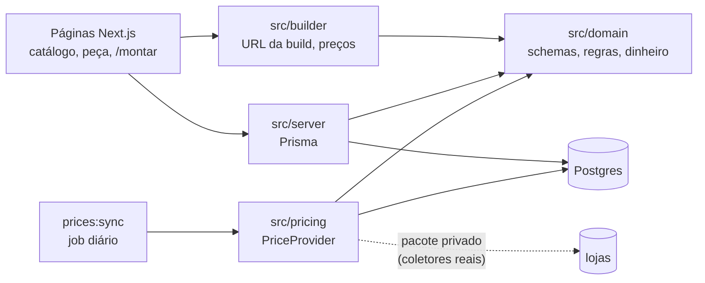

# custompc

[](https://github.com/sugixp/custompc/actions/workflows/ci.yml)
[](https://github.com/sugixp/custompc/actions/workflows/prices.yml)

**Português** · [English](#english)

Monte seu PC com **preços em reais**, links para **lojas brasileiras** e
**verificação de compatibilidade** entre as peças.

**Demo:** https://custompc-builder.vercel.app ·
[montar um PC](https://custompc-builder.vercel.app/montar)


## Destaques

- **20 regras de compatibilidade** (soquete, DDR, slots, folgas do
  gabinete, fonte, conectores da placa de vídeo…) num domínio em TypeScript
  puro, testado com objetos simples. O navegador roda o mesmo `checkBuild`
  do servidor, então cada regra existe uma vez só.
- **Specs reais, nunca inventadas:** 120 peças (15 por categoria) com
  dados das páginas dos fabricantes, cada uma guardando as URLs de origem.
  Campos que o fabricante não publica ficam de fora.
- **A build inteira na URL** (`/montar?cpu=…&ram=…*2`): link compartilhável,
  renderizado no servidor, um único link por build.
- **Fronteira público/privado:** a interface `PriceProvider` separa este
  repositório de um pacote privado com coletores de preço reais e IDs de
  afiliado. Os provedores rodam num job agendado, nunca durante a
  requisição.
- **Ofertas com prazo:** até 7 dias valem; até 30 aparecem como
  desatualizadas e saem do total; depois somem.
- **Qualidade:** 423 testes unitários, E2E com Playwright no desktop e no
  celular (teclado, acessibilidade com axe, banco fora do ar) num banco
  próprio, e CI com três jobs a cada push.
- **Deploy de verdade:** Vercel + Neon em São Paulo, migrations só no
  deploy, um banco (branch do Neon) por preview e preços de exemplo
  atualizados todo dia.

## Telas

| Desktop                                                                                                  | Celular                                                                       |
| -------------------------------------------------------------------------------------------------------- | ----------------------------------------------------------------------------- |
|  |  |
|          |                    |
|               |               |

## Por que o foco no Brasil

Os montadores de PC mais conhecidos mostram preços em dólar e lojas dos EUA.
Quem monta um PC no Brasil precisa comparar preços em reais entre Amazon,
Mercado Livre, KaBuM!, Pichau, Terabyte e outras lojas, e ainda conferir se
as peças funcionam juntas. O custompc junta as duas coisas.

## Stack

Next.js 16 (App Router, Cache Components) · React 19 · TypeScript (strict) ·
Tailwind CSS 4 · PostgreSQL 18 · Prisma 7 · Zod · Vitest · Playwright +
axe · GitHub Actions · Vercel · Neon

## Arquitetura



- **Domínio puro** (`src/domain`): schemas das peças, regras de
  compatibilidade, estimativa de consumo, dinheiro em centavos e validade
  das ofertas. Não importa Next.js, React nem Prisma; o ESLint garante.
- **Preços** (`src/pricing`): o `prices:sync` carrega os provedores
  listados em `PRICE_PROVIDERS`, valida cada oferta com Zod e grava em lote.
  As páginas só leem do banco. Preços de referência conferidos à mão entram
  por `prices:import` de uma planilha CSV (exemplo fictício em
  `data/prices.example.csv`) e sempre vencem os preços ilustrativos do seed.
- **Specs num JSON validado por Zod** em vez de uma tabela por categoria; as
  linhas são validadas na leitura, então dados ruins falham alto.
- **Renderização:** tudo que lê o banco, a URL ou o relógio vem em streaming
  dentro de `<Suspense>`, então o build não precisa de banco.

Detalhes, diagramas e como escrever um provedor privado:
[docs/architecture.md](docs/architecture.md). Regras de compatibilidade:
[docs/compatibility.md](docs/compatibility.md). Decisões e seus motivos:
[docs/STATUS.md](docs/STATUS.md).

## Deploy

| O quê         | Quando                    | Como                                         |
| ------------- | ------------------------- | -------------------------------------------- |
| App           | push no `main`            | Vercel (`gru1`, São Paulo)                   |
| Migrations    | todo deploy               | `vercel-build` → `prisma migrate deploy`     |
| Previews      | push em outra branch      | banco próprio: branch `preview/<git-branch>` |
| Catálogo      | à mão, quando o seed muda | workflow "Seed production"                   |
| Preços (demo) | todo dia                  | workflow "Price sync"                        |

O banco é Postgres no Neon (`sa-east-1`). Deploys nunca rodam o seed, e um
preview nunca roda migrations no banco de produção. Detalhes em
[docs/architecture.md](docs/architecture.md#deployment).

## Como rodar localmente

Requisitos: Node.js 24, npm e Docker (com Docker Compose).

```bash
npm install                # também gera o Prisma Client
cp .env.example .env       # conexão com o Postgres local
npm run db:up              # sobe o Postgres 18 no Docker
npm run db:deploy          # aplica as migrations
npm run db:seed            # carrega as peças de exemplo (pode rodar de novo)
npm run dev                # http://localhost:3000
```

O Postgres do Docker usa a porta **5432**. Se ela estiver ocupada (por
exemplo, por um Postgres instalado na máquina), defina `POSTGRES_PORT` no
`.env` (ex.: `5433`) e use a mesma porta no `DATABASE_URL`.
`npm run db:reset` recomeça do zero; `npm run db:down` para o banco (os
dados ficam no volume `custompc-db`).

> Os preços do seed são **ilustrativos**. As specs são reais, e cada peça
> guarda a página do fabricante de onde vieram
> ([docs/architecture.md](docs/architecture.md#seed-data)).

## Testes

```bash
npm run lint && npm run format:check && npm run typecheck
npm test            # unitários (Vitest)
npm run test:e2e    # E2E + acessibilidade (Playwright + axe)
```

O `test:e2e` precisa só do Postgres do `db:up`. Ele faz o build, recria um
banco `custompc_test` no mesmo servidor (migrations, seed e ofertas
envelhecidas) e sobe os próprios servidores nas portas 3100 e 3101; o banco
de desenvolvimento não é tocado.

## Scripts

| Comando                                | O que faz                                             |
| -------------------------------------- | ----------------------------------------------------- |
| `npm run dev`                          | Servidor de desenvolvimento                           |
| `npm run lint`                         | ESLint                                                |
| `npm run typecheck`                    | Checagem de tipos do TypeScript                       |
| `npm test`                             | Testes unitários (Vitest)                             |
| `npm run test:e2e`                     | Testes E2E e de acessibilidade (Playwright + axe)     |
| `npm run screenshots`                  | Gera os screenshots em `docs/screenshots`             |
| `npm run demo:media`                   | Grava o GIF e o vídeo do montador (precisa do ffmpeg) |
| `npm run format`                       | Formata o código com Prettier                         |
| `npm run db:up`                        | Sobe o Postgres (Docker)                              |
| `npm run db:deploy`                    | Aplica as migrations                                  |
| `npm run db:migrate`                   | Cria uma migration (desenvolvimento)                  |
| `npm run db:seed`                      | Carrega os dados de exemplo                           |
| `npm run db:reset`                     | Recria o banco e roda o seed                          |
| `npm run prices:sync`                  | Atualiza as ofertas a partir dos provedores de preço  |
| `npm run prices:import -- arquivo.csv` | Importa preços de referência conferidos à mão         |

## Status e roadmap

- ✅ **Fase 1 (MVP), concluída:** catálogo com filtros, página de cada peça
  com ofertas e ficha técnica, montador com compatibilidade ao vivo, total
  em R$ e por loja, consumo e fonte recomendada, link compartilhável, E2E
  no CI e deploy.
- ⏳ **Fase 2:** catálogo de 15 peças por categoria, preços de referência
  conferidos à mão, faixas de desempenho por perfil de uso, builds em
  destaque (Entrada, Intermediária, Alta) e o plano de recomendações.
- **Fase 3:** cadastro e login (e-mail e senha, Google, GitHub), builds e
  peças favoritas salvas, política de privacidade (LGPD, mínimo de dados).
- **Futuro:** recomendações automáticas ("Monte por mim"), histórico de
  preços, preços reais via pacote privado e links de afiliado.

Pendências conhecidas: a lista de CPUs suportadas por cada placa (para o
aviso de atualização de BIOS) precisa ser conferida à mão, porque os
fabricantes bloqueiam acesso automatizado; e há uma oferta por loja por
peça, uma limitação para marketplaces com vários vendedores.

## Licença

[MIT](LICENSE)

---

## English

Build your PC with **prices in Brazilian reais (R$)**, links to **Brazilian
stores** and **compatibility checks** between parts.

**Demo:** https://custompc-builder.vercel.app ·
[build a PC](https://custompc-builder.vercel.app/montar) (the UI is in
Portuguese).

### Highlights

- **20 compatibility rules** (socket, DDR generation, slots, case
  clearances, PSU wattage, GPU power connectors…) in a pure TypeScript
  domain, tested with plain objects. The browser runs the same `checkBuild`
  as the server, so every rule exists once.
- **Real specs, never invented:** 120 parts (15 per category) with data
  from manufacturer pages, each keeping its source URLs. Fields the
  manufacturer does not publish are left out.
- **The whole build lives in the URL** (`/montar?cpu=…&ram=…*2`):
  shareable, server-rendered, exactly one link per build.
- **Public/private boundary:** the `PriceProvider` interface separates this
  repo from a private package with real price collectors and affiliate ids.
  Providers run in a scheduled job, never during a request.
- **Offers expire:** fresh for 7 days; stale (shown, flagged, out of the
  total) up to 30; then hidden.
- **Quality:** 423 unit tests; Playwright E2E on desktop and mobile
  (keyboard, axe accessibility, database down) over their own database; CI
  with three jobs on every push.
- **Real deployment:** Vercel + Neon in São Paulo, migrations only at deploy
  time, a database (Neon branch) per preview, example prices refreshed
  daily.

### Why Brazil

Well-known PC builders show prices in US dollars and US stores. People
building a PC in Brazil need to compare prices in reais across Amazon,
Mercado Livre, KaBuM!, Pichau, Terabyte and other stores, and still check
that the parts work together. custompc does both.

### Architecture

A pure domain layer (`src/domain`) holds part schemas, compatibility rules,
the power estimate, money in integer cents and offer freshness, with no
Next.js, React or Prisma imports (ESLint enforces it). `src/pricing` loads
the providers listed in `PRICE_PROVIDERS`, validates each offer with Zod
and writes in batches; pages only read offers from the database. Specs live
in one Zod-validated JSON column instead of a table per category. Anything
that reads the database, the URL or the clock streams inside `<Suspense>`,
so the build needs no database. See the diagram above,
[docs/architecture.md](docs/architecture.md),
[docs/compatibility.md](docs/compatibility.md) and the decision log in
[docs/STATUS.md](docs/STATUS.md).

### Deployment

Pushes to `main` deploy to Vercel (`gru1`); the database is Postgres on Neon
(`sa-east-1`). Every deploy runs `prisma migrate deploy` and never seeds.
Each preview gets its own Neon branch `preview/<git-branch>`, and a check in
`vercel-build` keeps previews from migrating production. The catalog is
loaded by the "Seed production" workflow; the "Price sync" workflow
refreshes the example prices daily.

### Running locally

Requirements: Node.js 24, npm and Docker (with Docker Compose).

```bash
npm install                # also generates the Prisma Client
cp .env.example .env       # local Postgres connection
npm run db:up              # starts Postgres 18 in Docker
npm run db:deploy          # applies the migrations
npm run db:seed            # loads the example parts (safe to re-run)
npm run dev                # http://localhost:3000
```

Docker's Postgres listens on host port **5432**; if it is taken, set
`POSTGRES_PORT` in `.env` (e.g. `5433`) and use the same port in
`DATABASE_URL`. Seed prices are **illustrative**; part specs are real.
Reference prices checked by hand come from a CSV spreadsheet through
`npm run prices:import -- file.csv` (fictitious example in
`data/prices.example.csv`) and always outrank the illustrative ones.

### Testing

`npm test` runs the unit tests (Vitest). `npm run test:e2e` builds the app,
recreates a `custompc_test` database next to the Docker Postgres
(migrations, seed, aged offers) and runs Playwright with axe against its own
servers on ports 3100 and 3101; the development database is never touched.
The scripts table above lists the rest.

### Status and roadmap

- ✅ **Phase 1 (MVP), done:** catalog with filters, part pages with store
  offers and spec sheets, a builder with live compatibility, totals in R$
  and per store, power estimate and recommended PSU, shareable link, E2E in
  CI and deployment.
- ⏳ **Phase 2:** a 15-part catalog per category, hand-checked reference
  prices, performance tiers per usage profile, featured builds (Entry, Mid,
  High) and the recommendations plan.
- **Phase 3:** sign-up and login (email and password, Google, GitHub),
  saved builds and favorite parts, privacy policy (LGPD, minimal data).
- **Later:** automatic recommendations ("build it for me"), price history,
  real prices through the private package, affiliate links.

### License

[MIT](LICENSE)
