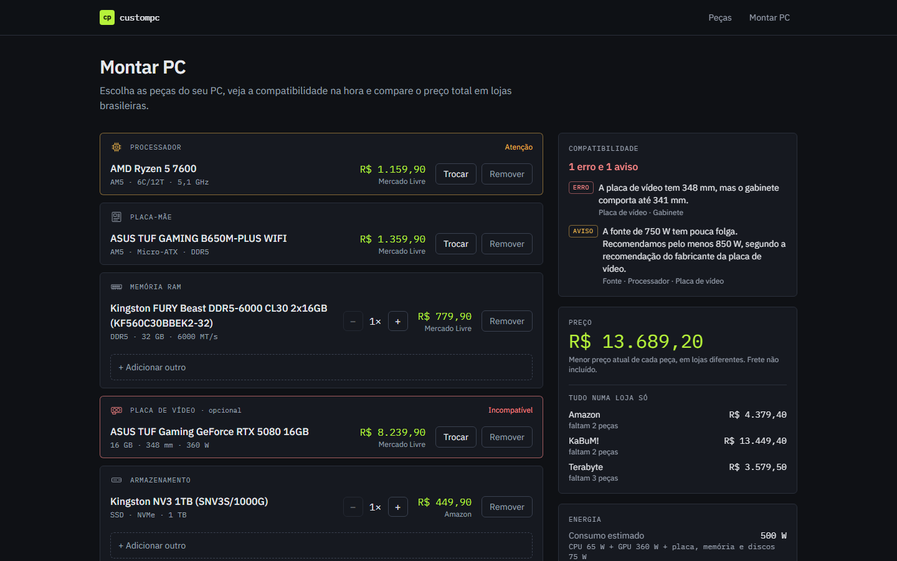
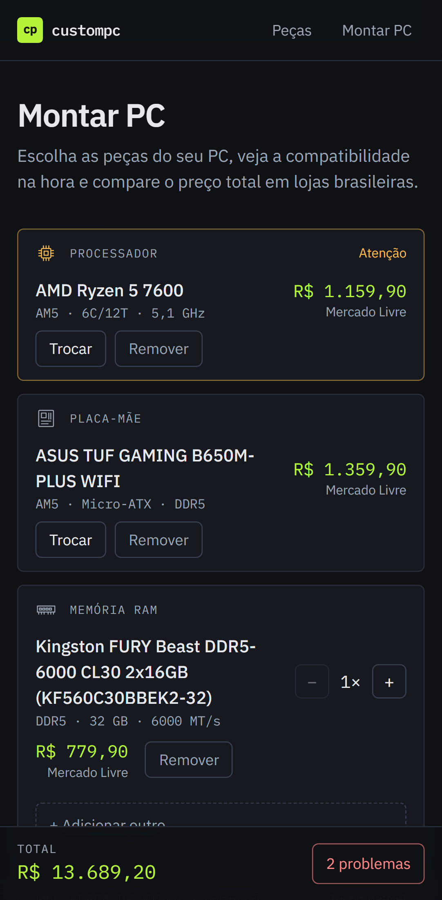
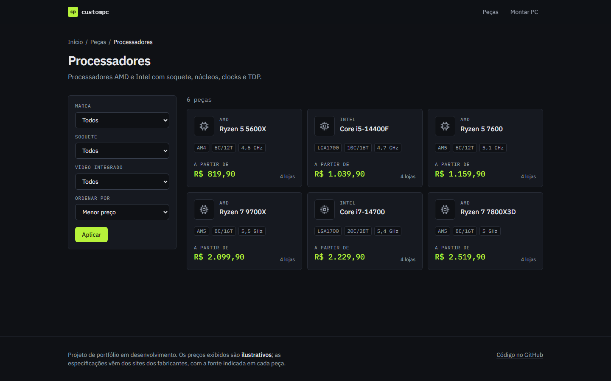
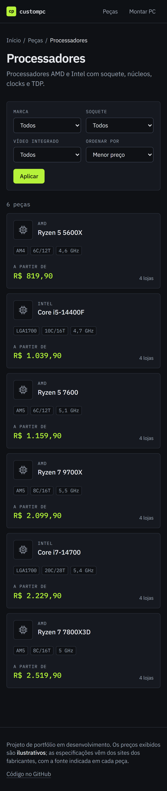
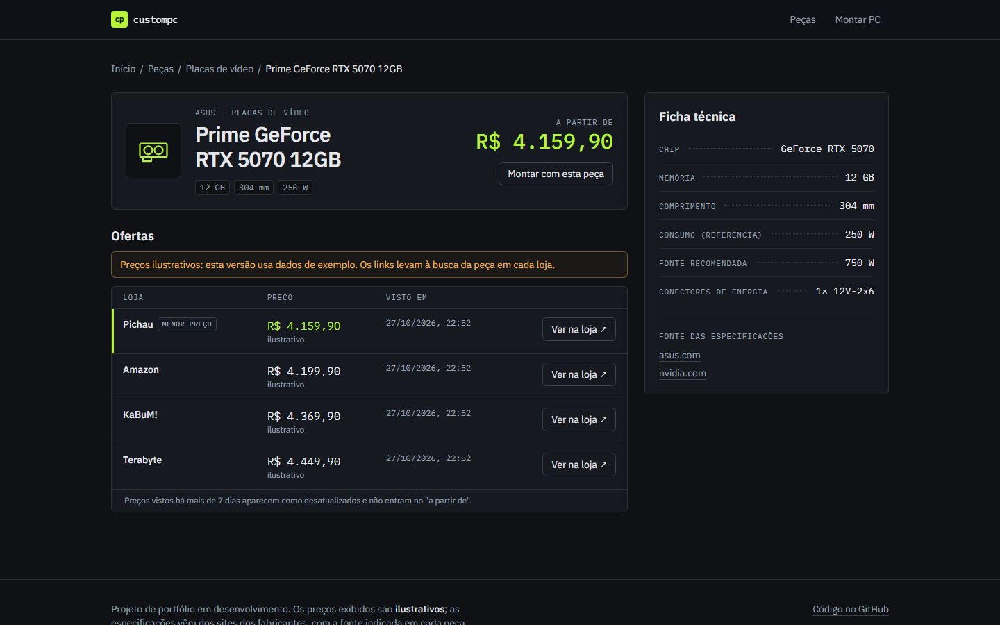
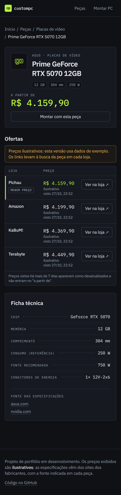

# custompc

[](https://github.com/sugixp/custompc/actions/workflows/ci.yml)

**Português** · [English](#english)

Monte seu PC com **preços em reais**, links para **lojas brasileiras** e
**verificação de compatibilidade** entre as peças.

> 🚧 Em construção — Fase 1 (MVP) em andamento.

## Telas

| Desktop                                                                                                  | Celular                                                                       |
| -------------------------------------------------------------------------------------------------------- | ----------------------------------------------------------------------------- |
|  |  |
|          |                    |
|               |               |


## Por que o foco no Brasil

Os montadores de PC mais conhecidos mostram preços em dólar e lojas dos EUA.
Quem monta um PC no Brasil precisa comparar preços em reais entre Amazon,
Mercado Livre, KaBuM!, Pichau, Terabyte e outras lojas — e ainda conferir se
as peças funcionam juntas. O custompc junta as duas coisas.

## Stack

Next.js (App Router) · TypeScript (strict) · Tailwind CSS · PostgreSQL ·
Prisma · Zod · Auth.js · Vitest · Playwright · GitHub Actions · Vercel

## Como rodar localmente

Requisitos: Node.js 24, npm e Docker (com Docker Compose).

```bash
npm install                # também gera o Prisma Client
cp .env.example .env       # conexão com o Postgres local
npm run db:up              # docker compose up -d --wait: sobe o Postgres 18
npm run db:deploy          # aplica as migrations
npm run db:seed            # carrega as peças de exemplo (pode rodar de novo)
npm run dev
```

Abra http://localhost:3000.

O Postgres do Docker usa a porta **5432** do host. Se ela já estiver ocupada
(por exemplo, por um Postgres instalado na máquina), defina `POSTGRES_PORT`
no `.env` (ex.: `5433`) e use a mesma porta no `DATABASE_URL`. Para recomeçar
do zero:
`npm run db:reset`. Para parar o banco: `npm run db:down` (os dados ficam no
volume `custompc-db`).

> Os preços do seed são **ilustrativos**. As specs das peças são reais e cada
> peça guarda a página do fabricante de onde vieram
> ([docs/architecture.md](docs/architecture.md#seed-data)).

## Scripts

| Comando               | O que faz                                              |
| --------------------- | ------------------------------------------------------ |
| `npm run dev`         | Servidor de desenvolvimento                            |
| `npm run lint`        | ESLint                                                 |
| `npm run typecheck`   | Checagem de tipos do TypeScript                        |
| `npm test`            | Testes unitários (Vitest)                              |
| `npm run test:e2e`    | Testes E2E (Playwright; requer build e banco com seed) |
| `npm run screenshots` | Gera os screenshots em `docs/screenshots`              |
| `npm run format`      | Formata o código com Prettier                          |
| `npm run db:up`       | Sobe o Postgres (Docker)                               |
| `npm run db:deploy`   | Aplica as migrations                                   |
| `npm run db:migrate`  | Cria uma migration (desenvolvimento)                   |
| `npm run db:seed`     | Carrega os dados de exemplo                            |
| `npm run db:reset`    | Recria o banco e roda o seed                           |
| `npm run prices:sync` | Atualiza as ofertas a partir dos provedores de preço   |

## Status

- ✅ Catálogo com filtros na URL, página de cada peça com ofertas e ficha técnica.
- ✅ Montador em `/montar`: compatibilidade ao vivo, total em R$, total por
  loja, consumo e fonte recomendada, link compartilhável.
- ✅ 20 regras de compatibilidade com testes; 43 peças reais com specs dos
  fabricantes; preços de exemplo.
- ⏳ Próximo: E2E completos no CI, README final, deploy (Vercel + Neon).

## Arquitetura

- **Domínio puro** (`src/domain`): schemas das peças, regras de
  compatibilidade, dinheiro em centavos e validade das ofertas, sem Next.js nem
  banco.
- **Preços** (`src/pricing`): a interface `PriceProvider` é a fronteira entre
  este repositório público e um pacote privado com os coletores reais e os IDs
  de afiliado. Os provedores rodam só no `npm run prices:sync`, nunca durante a
  requisição do usuário; as páginas leem as ofertas do banco.
- **Montador** (`src/builder` + `/montar`): a build inteira fica na URL
  (`?cpu=…&ram=…*2`); o servidor renderiza o link já montado e, no navegador,
  cada mudança roda o mesmo `checkBuild` do domínio.
- Ofertas com mais de 7 dias aparecem como desatualizadas; com mais de 30, somem.

Detalhes, diagrama e como escrever um provedor privado:
[docs/architecture.md](docs/architecture.md). Regras de compatibilidade:
[docs/compatibility.md](docs/compatibility.md).

## Roadmap

- **Fase 1 — MVP:** catálogo de peças, montador de build, verificação de
  compatibilidade e ofertas por loja (dados de exemplo).
- **Fase 2:** cadastro e login, builds e peças favoritas salvas, compartilhar
  build por link.
- **Fase 3:** sugestões por custo, performance e popularidade; histórico de
  preços.
- **Futuro:** monetização com links de afiliados e outras fontes de receita.

## Licença

[MIT](LICENSE)

---

## English

Build your PC with **prices in Brazilian reais (R$)**, links to **Brazilian
stores** and **compatibility checks** between parts.

> 🚧 Work in progress — Phase 1 (MVP) under way.

### Screenshots

See the table above: the builder with live compatibility checks, total and
per-store prices; the catalog with filters and prices in reais; a part page
with store offers and its spec sheet; and the home page with a real
compatibility check on seed parts.

### Status

Catalog, part pages and the builder at `/montar` work end to end on example
prices: live compatibility, total and per-store totals, power estimate and a
shareable link. Next: full E2E in CI, final README and deploy.

### Why Brazil

Well-known PC builders show prices in US dollars and US stores. People building
a PC in Brazil need to compare prices in reais across Amazon, Mercado Livre,
KaBuM!, Pichau, Terabyte and other stores, and still check that the parts work
together. custompc does both.

### Running locally

Requirements: Node.js 24, npm and Docker (with Docker Compose).

```bash
npm install                # also generates the Prisma Client
cp .env.example .env       # local Postgres connection
npm run db:up              # docker compose up -d --wait: starts Postgres 18
npm run db:deploy          # applies the migrations
npm run db:seed            # loads the example parts (safe to re-run)
npm run dev
```

Open http://localhost:3000. Docker's Postgres listens on host port **5432**;
if it is taken (e.g. by a natively installed Postgres), set `POSTGRES_PORT`
in `.env` (e.g. `5433`) and use the same port in `DATABASE_URL`.
`npm run db:reset` starts over; see the scripts table above.

> Seed prices are **illustrative**. Part specs are real, and each part keeps
> the manufacturer page they came from
> ([docs/architecture.md](docs/architecture.md#seed-data)).

### Architecture

A pure domain layer (`src/domain`) holds part schemas, compatibility rules,
money and offer freshness. `src/pricing` defines the `PriceProvider`
interface, the boundary between this public repo and a private package with
real price collectors and affiliate ids. Providers only run in
`npm run prices:sync`, never during a request; pages read offers from the
database. See [docs/architecture.md](docs/architecture.md).

### License

[MIT](LICENSE)
