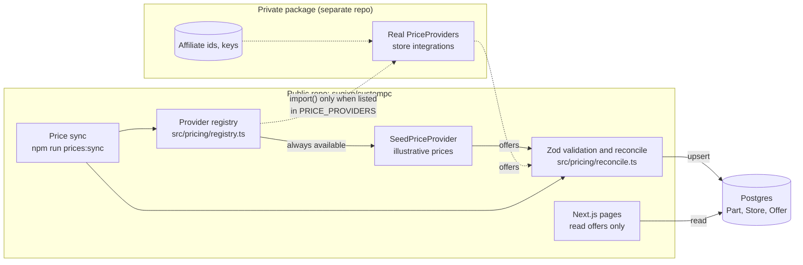

# Architecture

## Layers

```
src/domain/    pure TypeScript: part schemas, money, power estimate,
               compatibility rules, offer freshness. No Next.js, React,
               Prisma or app imports (enforced by ESLint).
src/pricing/   the PriceProvider contract, the provider registry and the
               price sync. Reaches storage only through the OfferRepository
               port (enforced by ESLint).
src/seed/      the example catalog: real parts, stores, illustrative offers,
               demo scenarios.
src/server/    server-side adapters: the Prisma client and the Prisma-backed
               OfferRepository.
src/app/       Next.js App Router pages and components.
prisma/        schema, migrations and the seed script.
scripts/       command-line entry points (price sync).
```

Dependencies point inward: `app` → `server` → `pricing` → `domain`. The
domain never knows where parts or prices come from, so the compatibility
rules are tested with plain objects and no database.

## Public and private code

This repository is public. Anything that is a business advantage stays out
of it: real price collectors, store integrations, affiliate ids and keys,
and store data gathered from them. That code lives in a separate **private
package** that implements the `PriceProvider` interface. The public code
only knows the interface.



The dashed arrows exist only where the private package is installed and
configured. Without it, build, tests and CI run as they do in this repo.

### How prices flow

1. `npm run prices:sync` (a scheduled job in production) loads the providers
   named in `PRICE_PROVIDERS`.
2. It reads the catalog (part slug, category, brand, model) and the store
   slugs from the database, and calls `fetchOffers({ parts, now })` on each
   provider.
3. Every offer is validated with `providerOfferSchema` (integer cents, https
   url, `inStock`, `seenAt` as a `Date`). Offers for unknown parts or stores,
   for stores the provider did not declare, or seen in the future are
   rejected and reported. One offer per part and store survives: the most
   recently seen.
4. The survivors are upserted in one transaction. A provider that throws is
   reported and skipped; the others still sync, and the script exits with
   code 1 so a scheduler notices.

**Providers never run during a page request.** Pages read offers from the
database, so a slow or blocked store can never slow down or break the site.

### Configuring providers

`PRICE_PROVIDERS` is a comma-separated list of `seed` (the built-in example
provider) and module specifiers of installed provider packages:

| `PRICE_PROVIDERS`              | Providers run                  |
| ------------------------------ | ------------------------------ |
| unset                          | `seed`                         |
| `@sugixp/custompc-prices`      | only the private package       |
| `seed,@sugixp/custompc-prices` | both; on a tie, the first wins |

A listed package that is not installed fails the sync with a clear message
instead of silently falling back to example prices.

### Writing a private provider

The contract is `src/pricing/price-provider.ts`:

```ts
interface PriceProvider {
  readonly id: string; // stored as Offer.source
  readonly storeSlugs: readonly string[]; // stores it reports on
  fetchOffers(request: {
    parts: readonly PartRef[];
    now: Date; // time of this sync run
  }): Promise<readonly ProviderOffer[]>;
}

interface PartRef {
  slug: string;
  category: Category; // "CPU" | "MOTHERBOARD" | ...
  brand: string;
  model: string;
}

interface ProviderOffer {
  partSlug: string;
  storeSlug: string; // must be in storeSlugs and in the Store table
  priceCents: number; // integer centavos
  url: string; // https; may carry affiliate parameters
  inStock: boolean;
  seenAt: Date; // when the price was observed
}
```

A private repository would:

1. Create a package (e.g. `@sugixp/custompc-prices`) whose default export is
   a `PriceProvider`, an array of them, or a (sync or async) factory that
   reads its own secrets from the environment and returns them.
2. Match catalog parts by `slug` (or brand and model) to the store's
   listings, and return normalized offers. It never writes to the database:
   validation and storage stay in the public sync.
3. Copy `price-provider.ts` for the types (it is MIT-licensed). The public
   code checks offers at runtime anyway, so the two never have to share a
   build.
4. Run the sync on a schedule from its own CI, for example a GitHub Actions
   cron job that checks out the public repo, installs the private package
   from a private registry, sets `PRICE_PROVIDERS` and the secrets, and runs
   `npm run prices:sync` against the production database.

## Offer freshness

`src/domain/pricing/freshness.ts` classifies offers by the time since
`seenAt`:

| Age          | Status    | In the UI                                    |
| ------------ | --------- | -------------------------------------------- |
| up to 7 days | `fresh`   | shown, counted in build totals               |
| 7 to 30 days | `stale`   | shown as "desatualizado", left out of totals |
| over 30 days | `expired` | hidden                                       |

The sync never deletes offers. When a provider stops reporting one, it ages
out on its own. The seed provider reports every offer as seen at sync time,
so example prices stay fresh as long as the sync runs.

## Data model

| Model   | Purpose                                                                                                                                                                                                      |
| ------- | ------------------------------------------------------------------------------------------------------------------------------------------------------------------------------------------------------------ |
| `Part`  | One real product. `category` is a Postgres enum; `specs` is JSON validated by the Zod schema of that category (`src/domain/parts`); `specSourceUrls` lists the manufacturer pages the specs were taken from. |
| `Store` | A Brazilian store (Amazon, Mercado Livre, KaBuM!, Pichau, Terabyte).                                                                                                                                         |
| `Offer` | A price for one part at one store: `priceCents` (integer centavos), `url`, `inStock`, `seenAt` and `source`, the id of the price provider that produced it.                                                  |

Specs live in one JSON column instead of a table per category. The schema
stays small, and Zod gives each category its own strict type at the boundary.
If filtering on a spec gets slow, that field can move to an indexed column.

## Seed data

`src/seed` holds real parts whose specs were copied from the manufacturers'
pages, with the URLs kept next to each part. A value a page does not state is
left out, never guessed: board CPU support lists and PSU modularity are absent
for that reason, and both fields are optional in the schema.

Offer prices in the seed are **illustrative**, derived from a rough reference
price per part. Offer links go to each store's public search page for the
part, with the term URI-encoded and no affiliate ids. Store images are not
copied or hotlinked; the UI uses placeholders per category.

`prisma/seed.ts` writes stores and parts, then loads offers from the seed
provider through the same sync as `npm run prices:sync`.

`src/seed/scenarios.ts` lists example builds of real parts that each trigger
one compatibility rule. `seed-data.test.ts` checks them against `checkBuild`,
validates every part with Zod and checks the offers, all without a database.
CI also migrates, seeds and syncs a fresh Postgres, then seeds again to prove
the seed is idempotent.

## Known limitations

- **One offer per part per store.** `Offer` has `@@unique([partId, storeId])`.
  Marketplaces such as Amazon and Mercado Livre list many sellers for the same
  product, at different prices, conditions and shipping. Phase 1 keeps the
  most recently seen price per store; supporting sellers means adding a seller
  (or listing) key to the unique constraint and choosing which offer to show.
- **No price history yet.** Upserting an offer overwrites the previous price.
  Price history is planned for phase 3 as a separate append-only table, which
  the sync can fill at the same point it upserts.
- **No board CPU support lists.** Vendors load them dynamically, and they
  could not be verified for the seed, so the BIOS-update warning has no demo
  scenario on real parts yet.
- **Specs are a snapshot.** Manufacturers revise pages (for example, a BIOS
  update raising a board's max memory). `specSourceUrls` makes rechecking
  possible but nothing does it automatically.
